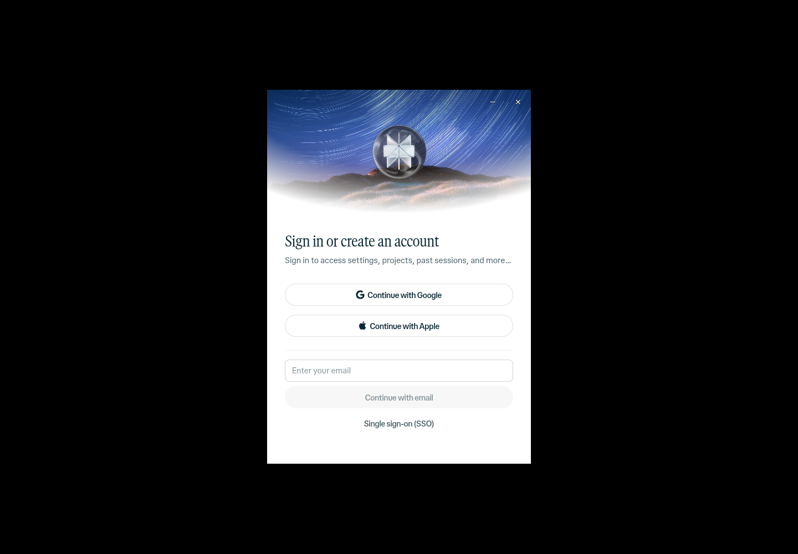

# PerplexityDeck

**Created by OSINTCabal**

Version **1.0.0**.

A Perplexity desktop integration for **Fedora and Debian Linux (x86-64)**. Keep the existing app and open it with `perplexitydeck`.

The current upstream package requires **glibc 2.39 or newer**: Fedora 44 and Debian 13 are the verification targets. Debian 12 is not supported by this package.

[Install](docs/INSTALL.md) · [Development](docs/DEVELOPMENT.md) · [Verification](docs/VERIFICATION.md)



## Features

Use the official Perplexity desktop application with its existing Linux window-layout fixes, persistent sign-in, desktop shortcuts, update checks, and rollback. The primary command and application-menu name are PerplexityDeck.

## How it works

The installer verifies the official Linux repository’s signed metadata against the pinned Perplexity public key, checks the package hashes, and prepares the application with the retained Linux shim. The shim preserves the existing interface and profile location. Application bundles, browser profiles, credentials, and downloaded packages stay outside Git.

Account access, online features, and usage limits are controlled by Perplexity. Reinstalling the integration preserves account data.

## Installation

Fedora and Debian use **one repository and the same installer**. Follow the [installation guide](docs/INSTALL.md), then run:

```bash
bash install.sh
perplexitydeck
```

The release verification targets are **Fedora 44 and Debian 13, x86-64**. See the [installation guide](docs/INSTALL.md) for dependencies.

## Screenshots

The signed-out start screen above uses a clean profile without account data. Sign-in is required for account-backed features.

## Notes

- This integration is unofficial and is not affiliated with Perplexity.
- The [MIT license](LICENSE) covers the integration source. The upstream application, artwork, and dependencies retain their own licenses.
- Browser authentication and service availability remain upstream features. See [verification](docs/VERIFICATION.md) for what was exercised.
- Runtime bundles, saved sign-ins, logs, and caches are excluded from the local Git repo.

## Coming soon

More desktop integration and broader Linux desktop testing are planned.

## Deck series

[VibeDeck](https://github.com/OSINTCabal/VibeDeck) · [GrokDeck](https://github.com/OSINTCabal/GrokDeck) · [KimiDeck](https://github.com/OSINTCabal/KimiDeck) · [MinimaxDeck](https://github.com/OSINTCabal/MinimaxDeck) · [ManusDeck](https://github.com/OSINTCabal/ManusDeck) · [CopilotDeck](https://github.com/OSINTCabal/CopilotDeck) · [DeepDeck](https://github.com/OSINTCabal/DeepDeck) · [JulesDeck](https://github.com/OSINTCabal/JulesDeck) · [MuseDeck](https://github.com/OSINTCabal/MuseDeck) · [ReplitDeck](https://github.com/OSINTCabal/ReplitDeck)

Part of the OSINTCabal Deck series. [OSINTCabal.org](https://OSINTCabal.org).
